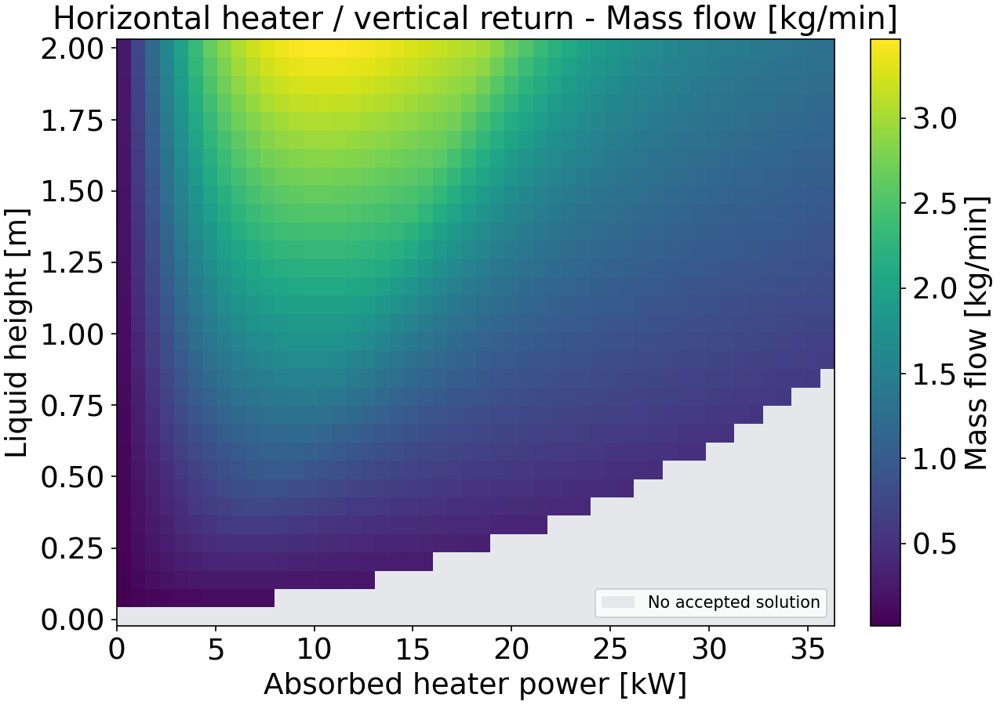
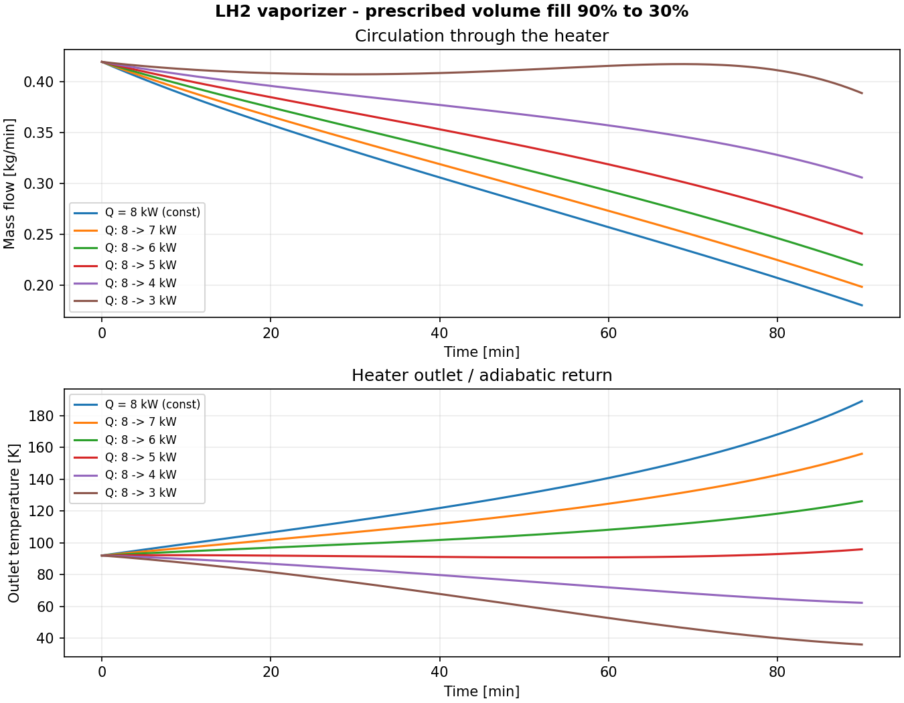
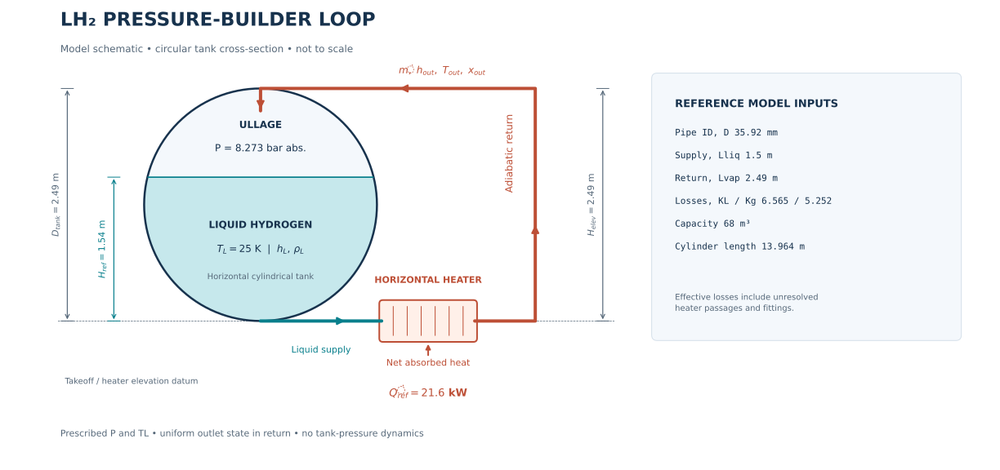

# LH₂ Pressure Builder

**A physics-based reduced-order model for natural circulation through a liquid-hydrogen pressure-builder vaporizer.**

[](https://www.mathworks.com/products/matlab.html)
[](https://coolprop.org/)
[](LICENSE)

A pressure builder uses heat to establish natural circulation in a cryogenic tank circuit. Subcooled LH₂ is withdrawn from the bottom of a horizontal tank, heated in a **horizontal vaporizer**, and returned through an **unheated vertical line** to the tank ullage. Heating reduces the return-fluid density; the resulting difference between the liquid supply head and return-column head drives circulation without a pump.

The model predicts the **steady circulation mass flow rate** (rather than prescribing it), heater outlet temperature/enthalpy/quality, and individual pressure losses from the imposed thermodynamic conditions, tank liquid level, pipe geometry, and heat absorbed by hydrogen. It replaces spatially resolved heater and flow calculations with fluid-property evaluations and one-dimensional *integral energy and momentum balances*—a physically interpretable **reduced-order model (ROM)**.

> [!IMPORTANT]
> **Scope:** This is a *quasi-steady vaporizer-loop model*, not a dynamic model of the complete tank. Tank pressure and inlet liquid temperature are imposed. It does **not** predict tank pressure rise, ullage temperature, condensation, or a coupled closed-tank pressurization transient. Time-dependent studies apply the steady solver repeatedly under prescribed conditions.

<p align="center">
  
  
</p>

*Examples: liquid-height/heater-power sweep (left) and prescribed state-of-charge drawdown (right). Blank map regions indicate **no accepted solution**, not zero mass flow.*



## Contents

- [Quick start: MATLAB](#quick-start-matlab)
- [How the model works](#how-the-model-works)
  - [Reduced-order representation](#1-reduced-order-representation)
  - [Energy and phase state](#2-energy-balance-and-phase-state)
  - [Driving head](#3-natural-circulation-driving-head)
  - [Hydraulic losses and governing equation](#4-hydraulic-losses-and-governing-equation)
- [How the equation is solved](#how-the-equation-is-solved)
- [MATLAB user guide](#matlab-user-guide)
- [Available studies](#available-studies)
- [Default configuration and calibration](#default-configuration-and-calibration)
- [Results and diagnostics](#results-and-diagnostics)
- [Python user guide](#python-user-guide)
- [Project files and tests](#project-files-and-tests)
- [Scope and limitations](#scope-and-limitations)
- [References](#references)

## Quick start: MATLAB

**The solver is written in MATLAB.** It calls the Python package [CoolProp](https://coolprop.org/) for hydrogen properties. Python is also used for optional plotting of previously calculated MATLAB results; the repository does **not** provide an independent Python thermosiphon solver.

1. **Install a Python interpreter and the dependencies.** From a terminal in the repository root:

   ```bash
   python -m pip install -r requirements.txt
   python -c "import sys, CoolProp; print(sys.executable, CoolProp.__version__)"
   ```

   The second command displays the **exact Python executable** to select in MATLAB and verifies that CoolProp is importable.

2. **Point MATLAB at that same Python interpreter** (example Windows path; replace with the path printed above):

   ```matlab
   pyenv('Version', 'C:\Path\To\python.exe');
   py.CoolProp.CoolProp.PropsSI('D','P',827300,'T',25,'parahydrogen')
   ```

   Configure `pyenv` before MATLAB initializes Python. See [MATLAB setup](#1-setup-and-run-the-default-studies) for environment notes.

3. **Set MATLAB's Current Folder to the cloned repository root** (the folder containing `Run_Vaporizer.m`), then execute:

   ```matlab
   Run_Vaporizer
   ```

4. **Find the outputs** in `results/` (`*.mat`) and `results/figures/` (`*.png`). In an interactive MATLAB session, the combined outputs are also in the workspace struct `results`.

To change a setting for one run, open [`Run_Vaporizer.m`](Run_Vaporizer.m), place an override immediately after `p = vap_default_params();`, and run it again. For example, `p.Qdot_ref = 18e3;` changes the **reference/calibration power**, whereas `p.Qdot_list = linspace(1,20,40)*1e3;` changes the **sweep power range**. These are different parameters because the studies have different operating schedules.

---

## How the model works

### 1. Reduced-order representation

The physical circuit has **three one-dimensional segments**. It is modeled at prescribed tank/loop reference pressure `P` and inlet liquid temperature `T_L`:

| Segment | Representation | Role |
|---|---|---|
| Liquid supply | Unheated pipe, length `L_liq`, diameter `D` | Carries liquid from the tank bottom to the heater |
| Vaporizer | Horizontal heater with imposed **net absorbed power** `Qdot` | Raises the circulating hydrogen enthalpy; its unresolved hydraulic resistance is included in effective loss coefficients |
| Return | Adiabatic pipe, length `L_vap`, elevation gain `H_elev` | Returns the heater outlet fluid to the ullage |

The liquid free-surface height above the tank bottom is `H`. By default, the return discharges at the tank top (`H_elev = D_tank`) and `L_vap = H_elev`. The horizontal heater contributes **no elevation head**.

The reduced-order formulation assumes:

- A single common mass flow rate through the loop, with no resolved axial temperature, void-fraction, or wall-temperature fields.
- Imposed reference pressure `P` for fluid-property evaluation and an imposed liquid inlet temperature `T_L`. The inlet must be liquid or saturated liquid.
- Negligible supply-line heating; prescribed net heat absorption in the heater; adiabatic return. At the imposed pressure, the return therefore uses the **heater-outlet enthalpy, density, and viscosity** throughout.
- One-dimensional homogeneous, no-slip treatment in the two-phase region. Liquid and vapor share a velocity; no separate phase-momentum or flow-pattern model is solved.
- Distributed pipe friction and effective lumped minor/heater losses in place of a geometrically resolved plate-vaporizer CFD model.

The common `P` is a **reference pressure for thermodynamic property calls**; the smaller driving and hydraulic pressure differences are still retained explicitly in the momentum balance. This is an approximation, not a resolved local pressure profile.

**Included phenomena:** liquid hydrostatic head; heating and possible evaporation/superheating; the liquid-to-return density contrast; single-phase or homogeneous two-phase fluid properties; Darcy pipe friction; fittings/unresolved heater resistance; and homogeneous acceleration due to density change. **Not resolved:** heater-wall temperatures, local nucleate/convective boiling coefficients, axial heat-transfer profiles, phase slip, tank ullage thermodynamics, or full transient momentum.

This formulation captures the main **density–flow–heating feedback**: increasing mass flow reduces the enthalpy added per kilogram, which changes return density and driving head, while hydraulic losses grow with flow.

### 2. Energy balance and phase state

For a trial positive circulation rate $\dot m$, the heater energy balance is

$$
\boxed{h_{\mathrm{out}}=h_L+\frac{\dot Q}{\dot m}}
$$

where $h_L=h(P,T_L)$ is the supply-liquid enthalpy and $\dot Q$ is the **net power absorbed by hydrogen** (W), not an independently calculated electrical-to-fluid efficiency. Wall heat storage and a spatially resolved boiling process are not part of the model.

At the imposed pressure, CoolProp provides the saturated-liquid and saturated-vapor values $h_f$, $h_g$, $\rho_f$, $\rho_g$, $\mu_f$, and $\mu_g$. The computed outlet enthalpy determines the regime:

| Enthalpy condition | Outlet regime | Outlet vapor quality |
|---|---|---|
| $h_{\mathrm{out}}<h_f$ | Liquid | $x_{\mathrm{out}}=0$ |
| $h_f\leq h_{\mathrm{out}}\leq h_g$ | Two phase, at $T_{\mathrm{sat}}(P)$ | $x_{\mathrm{out}}=(h_{\mathrm{out}}-h_f)/(h_g-h_f)$ |
| $h_{\mathrm{out}}>h_g$ | Dry / superheated vapor | $x_{\mathrm{out}}=1$ |

The useful phase-change threshold is the mass flow at which the supplied energy is just sufficient to reach saturated vapor:

$$
\dot m_{x=1}=\frac{\dot Q}{h_g-h_L}.
$$

At a fixed absorbed power, smaller trial flow rates have larger specific enthalpy rises and can enter the superheated-vapor region. This is a **phase boundary**, not an imposed circulation rate or a generally valid flow ceiling.

Single-phase outlet properties are evaluated from `(P, h_out)` with CoolProp. In the two-phase region, the homogeneous no-slip mixture closures implemented in [`vap_flow_state.m`](model/vap_flow_state.m) are

$$
\frac{1}{\rho_{\mathrm{out}}}
=\frac{1-x_{\mathrm{out}}}{\rho_f}+\frac{x_{\mathrm{out}}}{\rho_g},
\qquad
\frac{1}{\mu_{\mathrm{out}}}
=\frac{1-x_{\mathrm{out}}}{\mu_f}+\frac{x_{\mathrm{out}}}{\mu_g}.
$$

They recover the appropriate saturated-phase properties at $x=0$ and $x=1$. The outlet density and viscosity are also used for the uniform adiabatic return leg.

### 3. Natural-circulation driving head

Natural circulation results from the hydrostatic difference between the denser liquid supply and the lower-density return fluid:

$$
\boxed{
\Delta P_{\mathrm{drive}}
=g\left(\rho_L H-\rho_{\mathrm{out}}H_{\mathrm{elev}}\right)
}
$$

Here $\rho_L=\rho(P,T_L)$, $H$ is the available tank liquid height, and $H_{\mathrm{elev}}$ is the vertical return elevation. Heating may reduce $\rho_{\mathrm{out}}$ enough to produce a positive driving pressure, even though the return outlet is above the liquid level.

Importantly, **heater power does not directly prescribe flow**. It changes outlet enthalpy and density, which in turn modify the pressure head. The circulation rate is obtained only after matching that head to the full hydraulic resistance.

### 4. Hydraulic losses and governing equation

Both supply and return use a circular cross-section

$$
A=\frac{\pi D^2}{4},
\qquad
G=\frac{\dot m}{A},
$$

with mass flux $G$. The model includes **Darcy–Weisbach distributed friction**, **effective lumped losses**, and **homogeneous acceleration**:

$$
\begin{aligned}
\Delta P_{\mathrm{friction}}
&=\frac{G^2}{2}
\left(
\frac{f_L L_{\mathrm{liq}}}{D\rho_L}
+\frac{f_g L_{\mathrm{vap}}}{D\rho_{\mathrm{out}}}
\right),\\[3pt]
\Delta P_{\mathrm{minor}}
&=\frac{G^2}{2}
\left(\frac{K_L}{\rho_L}+\frac{K_g}{\rho_{\mathrm{out}}}\right),\\[3pt]
\Delta P_{\mathrm{acc}}
&=G^2\left(\frac{1}{\rho_{\mathrm{out}}}-\frac{1}{\rho_L}\right),\\[3pt]
\Delta P_{\mathrm{loss}}
&=\Delta P_{\mathrm{friction}}
+\Delta P_{\mathrm{minor}}
+\Delta P_{\mathrm{acc}}.
\end{aligned}
$$

- `K_L` and `K_g` are **effective**, inlet-/outlet-velocity-referenced coefficients; they include fittings and unresolved vaporizer-passage resistance. `K_g` names the outlet/return coefficient even when that stream is two-phase.
- Supply and return friction factors depend on their respective Reynolds numbers and the specified pipe roughness. The Darcy factor uses $64/\mathrm{Re}$ in laminar flow and the Haaland correlation in turbulent flow, with a smooth blend over $\mathrm{Re}=2300$–$4000$.
- The acceleration contribution accounts for the change in specific volume across heating under the homogeneous-flow assumption.

For both legs, the Darcy friction factor is evaluated using

$$
\mathrm{Re}_i=\frac{\dot m D}{A\mu_i}, \qquad i\in\{L,\mathrm{out}\}.
$$

The implementation uses $f=64/\mathrm{Re}$ for $\mathrm{Re}\le 2300$ and the **Haaland** explicit turbulent approximation for $\mathrm{Re}\ge 4000$:

$$
\frac{1}{\sqrt f}=-1.8\log_{10}\!\left[\left(\frac{\varepsilon/D}{3.7}\right)^{1.11}+\frac{6.9}{\mathrm{Re}}\right],
$$

with the implemented smooth transition

$$
s=\frac{\mathrm{Re}-2300}{1700}, \qquad
w=s^2(3-2s), \qquad
f=(1-w)\frac{64}{\mathrm{Re}}+wf_{\mathrm{Haaland}}
\quad (2300<\mathrm{Re}<4000).
$$

The effective `K` terms are referred to the common circular pipe area; a detailed boiling-dependent heater pressure-drop correlation is **not** solved separately.

The governing nonlinear steady equation is therefore

$$
\boxed{
F(\dot m)=
g\left(\rho_L H-\rho_{\mathrm{out}}(\dot m)H_{\mathrm{elev}}\right)
-\Delta P_{\mathrm{loss}}(\dot m)=0.
}
$$

**Unknown:** $\dot m$. **Specified inputs:** $(P,T_L,H,\dot Q)$ and the geometry/loss parameters. At each trial flow, the energy balance gives the outlet enthalpy; the property model gives the outlet state; and the momentum balance provides the pressure residual. The model does not assign a circulation rate in advance.

---

## How the equation is solved

[`model/vaporizer_thermosiphon.m`](model/vaporizer_thermosiphon.m) is the **single-operating-point solver**. Its input–output contract is:

```matlab
r = vaporizer_thermosiphon(P, T_L, H, Qdot, p);
% Inputs: P [Pa], T_L [K], H [m], Qdot [W], parameter struct p
% Main outputs: r.mdot [kg/s], r.T_out [K], r.x_out [-], r.ok, r.status
```

The algorithm solves the **nonlinear algebraic pressure balance** $F(\dot m)=0$—not a CFD model and not a transient ODE. Its evaluation sequence is:

```text
P, T_L, H, Qdot, pipe/tank geometry and effective losses
                  |
                  v
        CoolProp inlet/saturation properties
                  |
                  v
      Select a positive trial mass flow, mdot
                  |
                  v
     Energy: h_out = h_L + Qdot / mdot
                  |
                  v
  Identify phase; determine rho_out, mu_out, T_out
                  |
                  v
       Compute driving head and hydraulic losses
                  |
                  v
            F(mdot) = drive - losses
                  |
                  v
     Bracket and find root(s); verify all balances
                  |
                  v
    Unique accepted root, or explicit diagnostic status
```

**Implemented numerical procedure:**

1. Validate inputs and resolve derived geometry (`A`, return elevation/length, tank length); retrieve inlet and saturation properties from CoolProp. Inlet conditions must be in the liquid region.
2. Restrict positive trial flows to states that do not exceed the fluid-property domain or `p.T_out_max` (default **250 K**). Since $h_{\mathrm{out}}=h_L+\dot Q/\dot m$, excessively small trial flows may violate this outlet-state constraint. **This bound does not establish physical stagnation.**
3. Evaluate `vap_flow_state` at each candidate flow. Each evaluation recomputes outlet state, mixture properties, friction factors, driving head, losses, and `pressure_residual`.
4. Expand the search upper bound if necessary, sample the admissible flow range logarithmically, and explicitly include the saturated-liquid and saturated-vapor phase-transition mass flows in the grid. Use sign-change brackets and MATLAB `fzero` to find candidate roots.
5. Accept a result only if **one** admissible root satisfies the implemented pressure-residual tolerance, energy balance, and outlet-temperature limit. Return diagnostic information rather than arbitrarily selecting between multiple branches.

The properties at the imposed $(P,T_L)$ are cached by [`vap_thermo.m`](model/vap_thermo.m); `vap_coolprop.m` calls `py.CoolProp.CoolProp.PropsSI` using SI units. Fluid defaults to `parahydrogen`.

### What a returned solution means

| `r.status` | Meaning | `r.mdot` |
|---|---|---:|
| `solved` | Exactly one accepted positive-flow solution (`r.ok = true`) | Positive |
| `empty_tank` | No liquid at the bottom takeoff (`H = 0`); defined no-flow case | 0 |
| `zero_heat` | Zero absorbed heat and insufficient head; defined no-flow case | 0 |
| `no_root_in_domain` | No accepted root in the admissible property/flow/search domain | `NaN` |
| `multiple_roots` | More than one steady root; no model of branch stability to select one | `NaN` |
| `invalid_input`, `calculation_failed` | Input or calculation could not be accepted | `NaN` |

Genuine no-flow cases have no defined steady outlet state. A failed or ambiguous solve is **not** equivalent to zero circulation. Check `r.ok`, `r.status`, and `r.message` before using a result; inspect `r.root_candidates`, `r.pressure_residual`, and `r.energy_residual` when diagnosing a problem. Subsequent inventory-dependent time samples may be marked `upstream_failure` if an earlier solve failed.

---

## MATLAB user guide

### 1. Setup and run the default studies

Open MATLAB with the repository root as its current folder. Install `requirements.txt` in the intended Python environment and select that interpreter using `pyenv('Version', '...')` **before first Python use** in the session. You can inspect the active environment with `pyenv`. If you need to change an already-loaded Python environment, consult MATLAB's `pyenv` restart/reload guidance or restart MATLAB. The repository does not require Python packages to be installed into a separate MATLAB directory.

The one main entry point is [`Run_Vaporizer.m`](Run_Vaporizer.m):

```matlab
Run_Vaporizer
```

It automatically adds `model/`, `geometry/`, `studies/`, and `output/` to the path. The top of this script contains **study switches**, plotting/output options, then a shared parameter struct `p`. Its default switches are:

```matlab
RUN.sweep        = true;   % height x absorbed-power map
RUN.power_decay  = true;   % exponential heater-power decay
RUN.SOC          = true;   % prescribed 90% -> 30% volume fill
RUN.constH       = true;   % same powers, fixed liquid height
RUN.calibration  = false;  % optional one-point effective K_g fit
RUN.python_plots = false;  % optional Python figure regeneration

makePlots = true;          % save MATLAB-generated figures
outputDir = '';            % default = <repository root>/results

p = vap_default_params();  % edit/override fields directly below this line
```

You can run **only one study** by setting the other study switches to `false`. Set `makePlots = false` when you only need saved data. `RUN.calibration` returns a fitted *candidate*, but does **not** silently alter the parameters used in the other studies.

### 2. Find and change the correct input

For a reproducible one-off run, keep source defaults intact and change `p` **immediately after** `p = vap_default_params();` in `Run_Vaporizer.m`. To change the repository-wide default values instead, edit [`model/vap_default_params.m`](model/vap_default_params.m).

| Desired change | Parameter(s) | Units / scope |
|---|---|---|
| Tank/loop reference pressure and inlet liquid temperature | `p.P`, `p.T_L` | Pa, K; shared by studies |
| Hydrogen fluid model | `p.fluid` | Defaults to `parahydrogen` |
| Tank diameter and capacity | `p.D_tank`, `p.vol_L` | m, **litres** |
| Common supply/return inner diameter | `p.D` | m; `p.A = pi*p.D^2/4` is **recomputed automatically** |
| Supply length, return length and discharge elevation | `p.L_liq`, `p.L_vap`, `p.H_elev` | m; `[]` for return fields invokes geometry-based defaults |
| Wall roughness and effective resistances | `p.roughness`, `p.K_L`, `p.K_g` | m, dimensionless, dimensionless |
| Reference point / calibration conditions | `p.H_ref`, `p.Qdot_ref` | m, W; **not** the sweep/scenario schedule |
| Sweep grid | `p.H_list`, `p.Qdot_list` | m, W |
| SOC study: time step and duration | `p.scenario_dt`, `p.scenario_t_end` | s, s |
| SOC study: start and end volume fractions | `p.scenario_SOC0`, `p.scenario_SOC1` | 0–1 |
| SOC/constant-height studies: start/end heat inputs | `p.scenario_Q0`, `p.scenario_Q_end` | W; shared schedules |
| Power-decay study | `p.Qdot0`, `p.Qdot_tau`, `p.t_end`, `p.dt`, `p.H0` | W, s, s, s, m |
| Update liquid level in power-decay study? | `p.deplete_level` | Boolean |
| Outlet limit | `p.T_out_max` | K; `[]` uses fluid EOS limit |
| Solver search controls | `p.mdot_min`, `p.mdot_max`, `p.mdot_hard_max`, `p.bracket_points` | kg/s for flow bounds |
| Solver acceptance | `p.pressure_abs_tol`, `p.pressure_rel_tol` | Pa, dimensionless |

**Example A — customize the height–power sweep:**

```matlab
% In Run_Vaporizer.m, immediately after p = vap_default_params();
p.P = 9.0e5;                            % imposed pressure: 9 bar
p.T_L = 25.0;                           % inlet temperature: 25 K
p.D = 0.040;                            % both pipe IDs: 40 mm
p.L_liq = 2.0;                          % supply length: 2 m
p.K_g = 5.0;                            % effective outlet resistance
p.H_list = linspace(0.20, 2.00, 30);     % 30 liquid heights [m]
p.Qdot_list = linspace(2, 25, 40)*1e3;   % 40 absorbed powers [W]
p.T_out_max = 250;                      % maximum outlet temperature [K]
```

Enable `RUN.sweep = true`. The chosen grid will create `sweep_results.mat`. For consistent comparisons, leave all inputs other than the variable you intend to investigate unchanged.

**Example B — change the SOC and power-decay profiles:**

```matlab
p.scenario_SOC0 = 0.90;                 % initial volume fill
p.scenario_SOC1 = 0.30;                 % final imposed volume fill
p.scenario_t_end = 90*60;               % 90 minutes
p.scenario_Q0 = 28.8e3;                 % scenario starting power [W]
p.scenario_Q_end = [28.8,21.6,14.4]*1e3; % separate ending powers [W]

p.Qdot0 = 42e3;                         % exponential-decay starting power
p.Qdot_tau = 15*60;                     % decay time constant [s]
p.H0 = 1.20;                            % initial liquid height [m]
p.deplete_level = true;                 % update liquid inventory
```

The SOC and constant-height studies always use the **same** `scenario_Q0` and `scenario_Q_end` values; the difference is liquid height. Changing `p.Qdot_ref` alone does **not** change these schedules.

### 3. Solve just one operating point

If you want one custom result, rather than the full default study set, call the main solver directly. Start in the repository root:

```matlab
addpath('model','geometry','studies','output');
p = vap_default_params();
p.P = 8.273e5;                           % Pa
p.T_L = 25;                             % K
p.D = 0.03592;                          % m

r = vaporizer_thermosiphon(p.P, p.T_L, 1.54, 21.6e3, p);
if r.ok && strcmp(r.status,'solved')
    fprintf('Mass flow: %.4f kg/min\n', 60*r.mdot);
    fprintf('Outlet: %.2f K; quality: %.4f\n', r.T_out, r.x_out);
    fprintf('Driving head/loss: %.4f / %.4f Pa\n', r.dP_drive, r.dP_loss);
else
    fprintf('No accepted positive-flow result: %s — %s\n', r.status, r.message);
end
```

The fourth argument is **absorbed heat in watts**. `r.mdot` is in kg/s, so multiply by 60 to display kg/min. A status of `empty_tank` or `zero_heat` can have `r.ok = true` with zero flow but no defined outlet temperature.

## Available studies

All studies use the **same core solver and parameter struct**. They evaluate either independent operating points or a sequence of quasi-steady operating points; imposed time profiles must not be confused with a calculated tank pressurization transient.

| Study (`RUN.*`) | What is varied | Default setup / saved dataset |
|---|---|---|
| `sweep` | Liquid height and absorbed heater power | 32 heights (0.01–2.0 m) × 50 powers (0.36–36 kW); `sweep_results.mat` |
| `SOC` | Prescribed tank drawdown and heater-power schedules | Volume fill 90% → 30% over 90 min; power starts at 28.8 kW and ends at 28.8, 25.2, 21.6, 18, 14.4, or 10.8 kW; `SOC_scenario_results.mat` |
| `constH` | The **same power schedules** as `SOC`, but fixed liquid height | `H = 1.54 m`; isolates the effect of decreasing liquid head; `constH_scenario_results.mat` |
| `power_decay` | Exponentially decreasing absorbed power | $\dot Q(t)=42\,\mathrm{kW}\,\exp(-t/15\,\mathrm{min})$, 30-minute run, initial height 1.2 m; `power_decay_results.mat` |
| `calibration` | One-point effective return loss `K_g` | Optional diagnostic; does not overwrite source defaults or existing study datasets |

**Prescribed SOC study.** The given volume fraction $\mathrm{SOC}=V_L/V_{\mathrm{tank}}$ is converted to liquid height using the horizontal-cylinder geometry. For cylinder radius $R=D_{\mathrm{tank}}/2$, tank length $L_{\mathrm{tank}}$ and $0\le H\le 2R$:

$$
V_L(H)=L_{\mathrm{tank}}\left[R^2\cos^{-1}\!\left(\frac{R-H}{R}\right)
-(R-H)\sqrt{2RH-H^2}\right].
$$

The geometry helper implements a numerically stable equivalent form, including very low/high fills. The SOC time profile is externally specified; it is **not** inferred from computed vapor generation. The constant-height study reuses identical power profiles to isolate the effect of available liquid head.

These time-series scenarios represent a sequence of steady-state snapshots driven by imposed profiles; they do not integrate loop-fluid inertia or tank/ullage pressure dynamics.

**Power-decay inventory bookkeeping.** This study can update the liquid level from the portion vaporized and transferred to the ullage:

$$
\dot m_{\mathrm{vapor}}=x_{\mathrm{out}}\dot m,\qquad
m_{L,k+1}=\max\left(0,m_{L,k}-\dot m_{\mathrm{vapor},k}\,\Delta t\right).
$$

Returned liquid is treated as remaining in the tank; cumulative vapor transfer is **not an overall tank mass-loss prediction**. Pressure and inlet temperature remain fixed. Set `p.deplete_level = false` to hold liquid height externally constant instead.

## Default configuration and calibration

### Default reference configuration

The default parameters are defined in [`model/vap_default_params.m`](model/vap_default_params.m). All code-level quantities are in SI units.

| Parameter | Default |
|---|---:|
| Fluid | `parahydrogen` |
| Imposed pressure / liquid inlet temperature | 8.273 bar / 25 K |
| Tank diameter / geometric capacity | 2.49 m / 68,000 L |
| Supply and return pipe inner diameter `D` | 35.92 mm |
| Unheated liquid supply length `L_liq` | 1.5 m |
| Return elevation `H_elev` / length `L_vap` | Tank diameter / return elevation, unless overridden |
| Pipe roughness | 15 μm |
| Effective coefficients `K_L` / `K_g` | 6.565 / 5.252 |
| Reference height `H_ref` / absorbed power `Qdot_ref` | 1.54 m / 21.6 kW |
| Maximum admissible heater outlet temperature | 250 K |

The default represents a scaled geometry/power configuration; the effective coefficients are model assumptions (including the recorded friction-factor scaling from the earlier configuration), not independently resolved heater geometry. With the **unchanged default coefficients**, the reference regression case gives approximately **1.6093 kg/min** and **61.63 K**. These are model outputs, not experimental-validation claims.

### Optional one-point calibration

Enable `RUN.calibration = true` in `Run_Vaporizer.m`. By default, [`calibrate_vaporizer_loss.m`](studies/calibrate_vaporizer_loss.m) targets **0.30 × 3.6 = 1.08 kg/min** at the reference $(P,T_L,H_{\mathrm{ref}},\dot Q_{\mathrm{ref}})$. It holds all other parameters fixed, calculates the effective `K_g` needed for the target flow, and checks the fitted candidate with the independent root solve.

Calibration returns a candidate parameter struct (`results.calibration.p`) and report (`results.calibration.report`). It **does not modify** `vap_default_params.m`, replace the main study parameter struct, or retroactively recalibrate saved study results. A one-point fit is not independent experimental validation; transferring its effective resistance to other conditions remains a modeling assumption.

---

## Results and diagnostics

[`Run_Vaporizer.m`](Run_Vaporizer.m) exposes `makePlots` and `outputDir` near the top. `outputDir = ''` defaults to the repository's `results/` directory; `makePlots = true` also writes PNGs to its `figures/` subfolder.

| Study/output | Default file |
|---|---|
| Height × power sweep | `results/sweep_results.mat` |
| Exponential power decay | `results/power_decay_results.mat` |
| Prescribed SOC | `results/SOC_scenario_results.mat` |
| Fixed-height comparison | `results/constH_scenario_results.mat` |
| Generated graphics | `results/figures/*.png` |
| Interactive MATLAB return values | Workspace struct `results` (`results.sweep`, `.power_decay`, `.SOC`, `.constH`, optionally `.calibration`) |

**Inspect a saved sweep in MATLAB:**

```matlab
S = load('results/sweep_results.mat');
valid = S.ok;                          % logical validity mask
mdot_kg_min = 60*S.mdot_map;            % saved flows are in kg/s
mdot_kg_min(~valid) = NaN;             % retain failed points as gaps
disp(S.sp)                              % reference operating point
fprintf('Failed cases: %d\n', S.failed_count);
```

Useful returned quantities for any solved single point include `mdot`, `T_out`, `x_out`, `regime`, `rho_out`, `dP_drive`, `dP_friction`, `dP_minor`, `dP_acc`, `dP_loss`, `pressure_residual`, `energy_residual`, and `status`. For sweep arrays the corresponding main fields are `mdot_map`, `Tout_map`, `x_map`, `ok`, `status`, and `message`. Use the validity mask when calculating averages or plotting—**never substitute zero for an unsuccessful solve**. Blank map regions mean no accepted solution in the allowed model domain.

---

## Python user guide

### What Python can and cannot do in this repository

- **Without MATLAB:** Install `requirements.txt`, inspect existing `.mat` datasets with SciPy, regenerate all published figures, and regenerate the annotated schematic.
- **With MATLAB installed:** Launch the **MATLAB solver** from a Python script or terminal; modify its parameters in `Run_Vaporizer.m` or run a custom MATLAB statement. MATLAB itself still needs an accessible Python environment containing CoolProp.
- **Not provided:** a standalone/native Python translation of `vaporizer_thermosiphon.m`. Running only `python/plot_vaporizer_results.py` does **not** generate new simulations.

### A. Plot or analyze existing results (no MATLAB needed)

From the repository root:

```bash
python -m pip install -r requirements.txt
python python/plot_vaporizer_results.py
python python/plot_vaporizer_results.py --directory path/to/results
python python/generate_model_schematic.py
```

Use SciPy to load existing MATLAB result data (values remain in SI units):

```python
import numpy as np
from scipy.io import loadmat

s = loadmat('results/sweep_results.mat', simplify_cells=True)
ok = np.asarray(s['ok'], dtype=bool)
mdot_kg_min = np.where(ok, np.asarray(s['mdot_map']) * 60, np.nan)
print('Valid cases:', np.count_nonzero(ok), '/', ok.size)
print('Flow range [kg/min]:', np.nanmin(mdot_kg_min), np.nanmax(mdot_kg_min))
```

### B. Re-run the model from a Python terminal (MATLAB required)

After configuring MATLAB to use the installed CoolProp environment (see [Quick start](#quick-start-matlab)), you can run the main entry point from a terminal in the repository root:

```bash
matlab -batch "Run_Vaporizer"
```

Or call MATLAB from a Python script (e.g., save this as `run_from_python.py` in the repository root):

```python
from pathlib import Path
import subprocess

ROOT = Path(__file__).resolve().parent
subprocess.run(['matlab', '-batch', 'Run_Vaporizer'], cwd=ROOT, check=True)
# Once MATLAB exits, read the updated results/*.mat files with SciPy.
```

`matlab` must be available on your system `PATH`, or replace it with the full path to the MATLAB executable. The script respects the current switches and parameter overrides in `Run_Vaporizer.m`. MATLAB's `-batch` mode exits when the run completes and returns a nonzero process exit status if it encounters an uncaught error.

**To customize one operating point entirely from Python** while still using the validated MATLAB solver, you can send a MATLAB statement via `-batch` instead of editing its main script:

```python
from pathlib import Path
import subprocess

root = Path(__file__).resolve().parent   # script stored in repository root
statement = (
    "addpath('model','geometry','studies','output'); "
    "p=vap_default_params(); "
    "p.P=9e5; p.T_L=25; p.D=0.04; "
    "r=vaporizer_thermosiphon(p.P,p.T_L,1.4,18e3,p); "
    "assert(r.ok && strcmp(r.status,'solved'),r.message); "
    "fprintf('Flow: %.4f kg/min; Tout: %.2f K\\n',60*r.mdot,r.T_out);"
)
subprocess.run(['matlab', '-batch', statement], cwd=root, check=True)
```

For full height–power maps or SOC/power-decay studies, edit the `p.*` overrides and `RUN.*` switches in `Run_Vaporizer.m` as documented in the [MATLAB user guide](#matlab-user-guide); the command-line entry point then runs exactly those chosen studies. Setting `RUN.python_plots = true` also invokes the saved-result Python plotter from MATLAB after its studies.

---

## Project files and tests

```text
Run_Vaporizer.m          MATLAB entry point and study switches
model/                   Main solver, flow/thermodynamic states, CoolProp wrapper, defaults
geometry/                Horizontal-cylinder liquid height ↔ volume conversions
studies/                 Parameter sweep, scenarios, decay, calibration, inventory
output/                  MATLAB plotting and result paths/metadata
python/                  Saved-result figure generation and annotated schematic
results/                 Saved .mat datasets and figures/
docs/                    Model schematic (SVG/PNG)
tests/                   MATLAB and Python regression checks
requirements.txt         CoolProp and Python post-processing dependencies
LICENSE                  GNU GPL v3 or later
```

To run the regression tests (after setting up the MATLAB/Python environment):

```matlab
runtests('tests/test_vaporizer.m')
```

```bash
python -m unittest discover -s tests
```

The tests check geometry/inventory accounting, pressure and energy residuals, phase-boundary continuity, failure semantics, the calibration point, and consistency of committed reference datasets. Passing numerical tests confirms code/regression consistency, **not external experimental validation**.

## Scope and limitations

- **Not a closed-tank pressure model:** ullage pressure, thermodynamic equilibration, wall/tank heat transfer, condensation, and pressurization dynamics are not solved.
- **Quasi-steady:** no startup inertia, transient hydrodynamic instability, heater wall thermal storage, or dynamic phase-distribution model.
- **Homogeneous two-phase return:** no liquid–vapor slip, separate flow patterns, maldistribution, or two-phase stability prediction.
- **Lumped vaporizer hydraulics:** actual fin/plate passages and their localized phase-change friction are represented by effective `K` coefficients, not resolved geometry.
- **Idealized heat transfer:** net absorbed heater power is specified, and the return is adiabatic. Significant return-line heat leak or thermal coupling requires a more detailed model.
- **Restricted solution domain:** a temperature cap or absence of a verified root means the modeled configuration has **no accepted result within the search domain**, not necessarily zero physical circulation. Multiple steady roots are reported but not ranked by stability.

For source details, start with [`vaporizer_thermosiphon.m`](model/vaporizer_thermosiphon.m) (root finding) and [`vap_flow_state.m`](model/vap_flow_state.m) (state and pressure balance).

## References

The following are **foundational references relevant to the physical principles and numerical/property methods**, rather than a claim that every correlation or assumption in each publication is implemented here. In particular, heat transfer is represented by **imposed absorbed power**, not by an Incropera-style heat-transfer-coefficient calculation; the homogeneous mixture approach is simpler than a general two-fluid flow model.

1. **General heat-transfer principles:** T. L. Bergman, A. S. Lavine, F. P. Incropera, and D. P. DeWitt, *Fundamentals of Heat and Mass Transfer*, 8th ed., Wiley, 2018. [Publisher](https://www.wiley.com/en-us/fundamentals-of-heat-and-mass-transfer-8th-edition-p-9781119353881).
2. **Control-volume balances and pipe flow:** F. M. White, *Fluid Mechanics*, 9th ed., McGraw Hill, 2021. [Publisher](https://www.mheducation.ca/product/ise-fluid-mechanics-9781260575545-can-group).
3. **Background on boiling and two-phase pressure drop:** J. G. Collier and J. R. Thome, *Convective Boiling and Condensation*, 3rd ed., Oxford University Press, 1994. [DOI: 10.1093/oso/9780198562825.001.0001](https://doi.org/10.1093/oso/9780198562825.001.0001). This is background context; the model uses a simplified homogeneous no-slip closure rather than the book's detailed two-phase correlations.
4. **Fitting/pipe loss engineering context:** Crane Co., *Flow of Fluids Through Valves, Fittings, and Pipe*, Technical Paper No. 410 (TP-410), 2018 ed. [Publisher announcement](https://www.cranebsu.com/en/news/view/new-flow-of-fluids-tp-410-2018-edition-now-available). The model uses effective—not individually resolved—fitting/heater loss coefficients.
5. **Explicit turbulent friction factor implemented in the solver:** S. E. Haaland, “Simple and Explicit Formulas for the Friction Factor in Turbulent Pipe Flow,” *Journal of Fluids Engineering* **105**(1), 89–90 (1983). [DOI: 10.1115/1.3240948](https://doi.org/10.1115/1.3240948).
6. **CoolProp library used for fluid-property calls:** I. H. Bell, J. Wronski, S. Quoilin, and V. Lemort, “Pure and Pseudo-pure Fluid Thermophysical Property Evaluation and the Open-Source Thermophysical Property Library CoolProp,” *Industrial & Engineering Chemistry Research* **53**(6), 2498–2508 (2014). [DOI: 10.1021/ie4033999](https://doi.org/10.1021/ie4033999).
7. **Hydrogen thermodynamic equation-of-state background used by CoolProp:** J. W. Leachman, R. T. Jacobsen, S. G. Penoncello, and E. W. Lemmon, “Fundamental Equations of State for Parahydrogen, Normal Hydrogen, and Orthohydrogen,” *Journal of Physical and Chemical Reference Data* **38**(3), 721–748 (2009). [DOI: 10.1063/1.3160306](https://doi.org/10.1063/1.3160306).

## Author and license

**Albert Gil-Esmendia** · UC Irvine · [LinkedIn](https://www.linkedin.com/in/albertgilesmendia/) · [Google Scholar](https://scholar.google.com/citations?user=R_3V20cAAAAJ&hl=ca)

Released under the **GNU General Public License v3 or later**; see [`LICENSE`](LICENSE). Questions, reproducible bug reports, and improvement suggestions are welcome through GitHub Issues.
