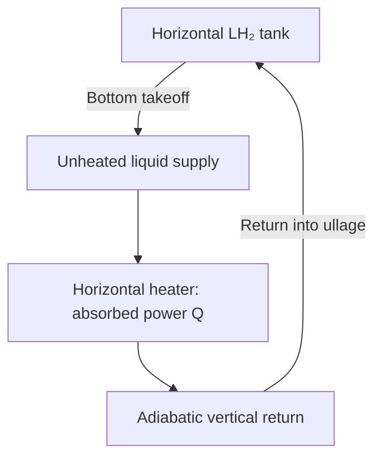

# LH₂ Pressure Builder

**A MATLAB reduced-order model of natural circulation through a liquid-hydrogen pressure-builder vaporizer.**

[](https://www.mathworks.com/products/matlab.html)
[](https://coolprop.org/)
[](https://www.python.org/)
[](LICENSE)

Liquid leaves the bottom of a horizontal cylindrical LH₂ tank, absorbs heat in a horizontal heater, and returns through an unheated vertical pipe into the ullage. The model predicts circulating flow and outlet state by balancing liquid supply head against return-column head, friction, fittings, and acceleration losses.

**Scope:** this is a quasi-steady vaporizer-loop model at imposed tank pressure and liquid temperature. It does **not** calculate tank pressure rise, ullage heating, condensation, or a closed-tank pressurization transient.

<p align="center">


</p>

Blank map regions represent cases without an accepted solution in the configured search domain. They must not be interpreted as zero circulation.

## Contents

- [Capabilities](#capabilities)
- [Physical configuration](#physical-configuration)
- [Governing equations](#governing-equations)
- [Numerical solution](#numerical-solution)
- [Default configuration](#default-configuration)
- [Installation](#installation)
- [Running simulations](#running-simulations)
- [Calibration](#calibration)
- [Outputs and provenance](#outputs-and-provenance)
- [Status and failure handling](#status-and-failure-handling)
- [Reference results](#reference-results)
- [Tests and GitHub CI](#tests-and-github-ci)
- [Repository layout](#repository-layout)
- [Troubleshooting](#troubleshooting)
- [Limitations](#limitations)
- [Contributing](#contributing)
- [References](#references)
- [Author and license](#author-and-license)

## Capabilities

- Solve individual operating points for circulation, temperature, vapor fraction, and pressure-loss components.
- Map performance across liquid height and absorbed heater power.
- Compare prescribed SOC drawdown with constant liquid height using identical power schedules.
- Track liquid-to-vapor inventory transfer during exponentially decaying heater power.
- Fit an effective return-loss coefficient to a flow measurement or design target.
- Save parameters, validity flags, residuals, diagnostics, and provenance with each dataset.
- Generate eleven figures through MATLAB or a standalone Python plotter.

Internally, units are kg/s, Pa, W, m, K, and J/kg. Figures generally show **kg/min** and **kW**. The calibration function accepts a target in **kg/min**.

## Physical configuration



The tank is a horizontal circular cylinder with flat ends. `H` is liquid height above the bottom takeoff; `H_elev` is return elevation above the heater. By default the return reaches the tank top, so `H_elev = D_tank`.

| Assumption | Implementation |
|---|---|
| Quasi-steady circulation | Each sample is an independent steady momentum/energy solution. |
| Imposed reservoir conditions | `P` and `T_L` remain prescribed, including during inventory integration. |
| Lumped horizontal heater | Net absorbed power raises enthalpy without elevation head. |
| Adiabatic return | Enthalpy, density, and viscosity are uniform and equal to heater-outlet values. |
| Representative constant pressure | Properties use one pressure; distributed flashing from local pressure changes is not resolved. |
| Common circular pipe area | Supply and return velocities use `A = pi*D^2/4`. |
| Effective heater/fitting losses | Unresolved passages and fittings are lumped into `K_L` and `K_g`. |
| Homogeneous two-phase flow | Liquid and vapor have no slip. |
| Forward flow only | Reverse circulation and branch stability are outside the model. |

`K_g` is the historical name for the **return-side** coefficient. It also applies to liquid and two-phase return states.

## Governing equations

### Thermodynamic properties

CoolProp supplies **parahydrogen** properties. Inlet enthalpy, density, and viscosity use the actual imposed liquid state:

$$
h_L=h(P,T_L),\qquad \rho_L=\rho(P,T_L),\qquad \mu_L=\mu(P,T_L).
$$

Saturation properties at `P` define `T_sat`, `h_f`, `h_g`, `rho_f`, `rho_g`, `mu_f`, and `mu_g`. The inlet must be within the fluid domain and at or below saturation temperature. Within $10^{-7}$ K of saturation, saturated-liquid inlet properties are used. Supercritical pressures do not provide the saturation states needed by this formulation.

### Heater energy balance

For positive circulation:

$$
h_{out}=h_L+\frac{\dot Q}{\dot m}.
$$

Here $\dot Q$ means **net absorbed heat**, not electrical input or ambient-air vaporizer rating.

| Enthalpy | Regime | Outlet calculation |
|---|---|---|
| $h_{out}<h_f$ | `liquid` | Properties at $(P,h_{out})$; `x_out = 0`. |
| $h_f\le h_{out}\le h_g$ | `two_phase` | `T_out = T_sat`; homogeneous mixture. |
| $h_{out}>h_g$ | `dry_vapor` | Properties at $(P,h_{out})$; `x_out = 1`. |

In the two-phase region:

$$
x_{out}=\frac{h_{out}-h_f}{h_g-h_f},
$$

$$
\rho_{out}=\left(\frac{1-x_{out}}{\rho_f}+\frac{x_{out}}{\rho_g}\right)^{-1},\qquad
\mu_{out}=\left(\frac{1-x_{out}}{\mu_f}+\frac{x_{out}}{\mu_g}\right)^{-1}.
$$

Outside this region, `x_out` is a regime indicator set to 0 or 1; it is not thermodynamic quality for superheated vapor.

The saturated-vapor outlet boundary is:

$$
\dot m_{sat}=\frac{\dot Q}{h_g-h_L}.
$$

The code names this `mdot_Q_ceiling` / `ceiling_vs_Q`. It is the **complete-vaporization boundary**, not a universal circulation limit: higher circulation can return as mixture or liquid.

### Momentum balance

With mass flux $G=\dot m/A$:

$$
\Delta P_{drive}=g(\rho_L H-\rho_{out}H_{elev}),
$$

$$
\Delta P_{friction}=\frac{G^2}{2}\left(\frac{f_L L_{liq}}{D\rho_L}+\frac{f_g L_{vap}}{D\rho_{out}}\right),
$$

$$
\Delta P_{minor}=\frac{G^2}{2}\left(\frac{K_L}{\rho_L}+\frac{K_g}{\rho_{out}}\right),
$$

$$
\Delta P_{acc}=G^2\left(\frac{1}{\rho_{out}}-\frac{1}{\rho_L}\right).
$$

The solver finds a root of:

$$
R_P(\dot m)=\Delta P_{drive}-\Delta P_{friction}-\Delta P_{minor}-\Delta P_{acc}=0.
$$

Reynolds numbers are $Re_L=\dot mD/(A\mu_L)$ and $Re_g=\dot mD/(A\mu_{out})$. Darcy friction is $64/Re$ below `Re = 2300` and Haaland above `Re = 4000`:

$$
f=\left[-1.8\log_{10}\left(\left(\frac{\epsilon/D}{3.7}\right)^{1.11}+\frac{6.9}{Re}\right)\right]^{-2}.
$$

A cubic smoothstep blends the two expressions through transition.

### Geometry and liquid inventory

For tank radius $R$, cylindrical length $L$, and liquid height $H$:

$$
V_L(H)=L\left[R^2\cos^{-1}\left(\frac{R-H}{R}\right)-(R-H)\sqrt{2RH-H^2}\right].
$$

Equivalent minor-segment expressions and a small-angle series improve stability near empty/full conditions. The inverse recovers height from volume, including exact endpoints.

`SOC` means **liquid volume fraction**, $V_L/V_{tank}$, not height fraction or vapor mass fraction.

Power-decay inventory advances as:

$$
\Delta m_{vap}=\min(m_{L,k},x_{out,k}\dot m_k\Delta t_k),\qquad
m_{L,k+1}=m_{L,k}-\Delta m_{vap}.
$$

Returned liquid stays in the liquid pool. `mass_vaporized` is cumulative liquid-to-vapor transfer, **not vented or lost hydrogen**. Vapor pressure, gas temperature, condensation, and changing liquid density are not integrated.

## Numerical solution

The single-point solver:

1. Validates inputs and derives pipe area and tank length.
2. Obtains inlet and saturation properties.
3. Handles defined empty-tank and zero-heat no-flow cases.
4. Converts the outlet-temperature cap into a minimum trial flow, also bounded by `mdot_min`.
5. Expands the upper flow bound when needed, up to `mdot_hard_max`.
6. Samples a logarithmic grid and inserts phase-boundary flows.
7. Solves detected sign-changing brackets with `fzero` and merges duplicate candidates.
8. Accepts one root only when pressure, energy, and temperature checks pass.

Pressure acceptance requires:

$$
|R_P|\le P_{abs,tol}+P_{rel,tol}\max(|\Delta P_{drive}|,|\Delta P_{loss}|).
$$

Energy acceptance requires $|\dot m(h_{out}-h_L)-\dot Q|\le10^{-8}\max(\dot Q,1)$ in SI units. Outlet temperature may exceed the effective cap by no more than $10^{-6}$ K.

The finite bracket search does not prove global uniqueness or detect every possible tangent/narrow root. Multiple detected roots are reported without selecting a stable branch.

## Default configuration

`model/vap_default_params.m` is the source of truth. These are the **current uncalibrated defaults**.

### Fluid, tank, and loop

| Parameter | Default | Units / meaning |
|---|---:|---|
| `fluid` | `parahydrogen` | CoolProp name |
| `P` | 827,300 | Pa; 8.273 bar absolute |
| `T_L` | 25.0 | K; imposed liquid inlet |
| `g` | 9.81 | m/s² |
| `D_tank` | 2.49 | m |
| `vol_L` | 68,000 | L; total cylindrical capacity |
| `tank_length` | approximately 13.9643 | m; derived from capacity and diameter |
| `H_ref` | 1.54 | m |
| `D` | 0.03592 | m; common supply/return internal diameter |
| `A` | `pi*D^2/4` | m²; recomputed during validation |
| `L_liq` | 1.5 | m; unheated supply |
| `H_elev` | `[]` → 2.49 | m; empty derives from `D_tank` |
| `L_vap` | `[]` → 2.49 | m; empty derives from `H_elev` |
| `roughness` | 15 × 10⁻⁶ | m |
| `K_L` | 6.565 | Effective supply coefficient |
| `K_g` | 5.252 | Effective return coefficient |
| `Qdot_ref` | 21,600 | W; reference absorbed power |
| `STM_mdot_annotation` | `1.1/60` | kg/s; legacy comparison field, not a solver input or calibration target |

This design uses nominal **3.6× scaling** relative to a historical 20 mm / 6 kW configuration. Diameter is now 35.92 mm, reference power 21.6 kW, and effective losses were scaled using an assumed fully turbulent friction-factor ratio. These are design assumptions, not exact similarity laws or experimental validation. Historical 27 K inlet cases should not be compared directly with the current 25 K defaults.

### Studies

| Parameter | Default |
|---|---|
| `H_list` | 32 heights, 0.01–2.0 m |
| `Qdot_list` | 50 powers, 0.36–36 kW |
| `scenario_t_end`, `scenario_dt` | 5,400 s and 30 s; 181 samples |
| `scenario_Q0` | 28.8 kW |
| `scenario_Q_end` | 28.8, 25.2, 21.6, 18.0, 14.4, 10.8 kW |
| `scenario_SOC0`, `scenario_SOC1` | 0.90 and 0.30 |
| `t_end`, `dt` | 1,800 s and 30 s; 61 power-decay samples |
| `Qdot0`, `Qdot_tau` | 42 kW and 900 s |
| `H0` | 1.2 m |
| `deplete_level` | `true` |

### Solver controls

| Parameter | Default | Purpose |
|---|---:|---|
| `mdot_min` | 1 × 10⁻⁸ kg/s | Lower search bound; not a stagnation threshold |
| `mdot_max` | 0.5 kg/s | Initial upper bound |
| `mdot_hard_max` | 5 kg/s | Expanded upper limit |
| `bracket_points` | 48 | Base logarithmic sample count |
| `pressure_abs_tol` | 1 × 10⁻⁵ Pa | Absolute pressure tolerance |
| `pressure_rel_tol` | 1 × 10⁻⁸ | Relative pressure tolerance |
| `T_out_max` | 250 K | Outlet cap; `[]` uses the fluid EOS maximum |

The temperature cap restricts accepted steady solutions. It does not model a controller, wall temperature, or a guarantee that hardware cannot exceed 250 K.

## Installation

### Requirements

- MATLAB with Python integration. Saved datasets were generated with **R2026a Update 5**; earlier releases have not been verified here.
- A Python interpreter compatible with your MATLAB release. The recorded environment uses **Python 3.12.10**.
- **CoolProp 7.2.0** for model properties.
- NumPy, SciPy, and Matplotlib for Python plotting and reference-data tests.
- Git for cloning and optional provenance; source archives can run without Git history.

No additional MATLAB toolbox is explicitly required by the model routines. Tests use the MATLAB unit testing framework through `runtests`.

### Clone and install Python dependencies

```bash
git clone https://github.com/Albert-Gil/LH2-PressureBuilder.git
cd LH2-PressureBuilder
python -m venv .venv
```

Activate in PowerShell:

```powershell
.\.venv\Scripts\Activate.ps1
```

Or a POSIX shell:

```bash
source .venv/bin/activate
```

Install with the interpreter MATLAB will use:

```bash
python -m pip install -r requirements.txt
python -c "import CoolProp.CoolProp as CP; print(CP.PropsSI('T','P',101325,'Q',0,'Parahydrogen'))"
```

`requirements.txt` pins CoolProp and bounds plotting-library versions. It is not a full environment lock. A locally checked plotting environment used NumPy 2.1.3, SciPy 1.15.3, and Matplotlib 3.10.3.

### Configure MATLAB's interpreter

Open MATLAB in the repository. Before loading Python, select the interpreter containing CoolProp:

```matlab
% Windows example: replace with your absolute interpreter path.
pyenv('Version','C:\path\to\LH2-PressureBuilder\.venv\Scripts\python.exe');
pyenv
double(py.CoolProp.CoolProp.PropsSI('T','P',101325,'Q',0,'Parahydrogen'))
```

Linux/macOS environment paths usually end in `.venv/bin/python`. If another interpreter is already loaded, restart MATLAB before selecting a different one.

## Running simulations

### Main entry point

```matlab
main_vaporizer
```

| Option | Default | Effect |
|---|---|---|
| `RUN.sweep` | `true` | Height–power map |
| `RUN.power_decay` | `true` | Inventory integration during power decay |
| `RUN.SOC` | `true` | Prescribed declining volume fill |
| `RUN.constH` | `true` | Constant height at `H_ref` |
| `RUN.calibration` | `false` | Fit `K_g` into a separate returned struct |
| `RUN.python_plots` | `false` | Invoke Python plotting with MATLAB's interpreter |
| `makePlots` | `true` | Generate MATLAB figures |
| `outputDir` | `''` | Use `<project>/results` |
| `calibration_target_kg_min` | `0.30*3.6` = **1.08** | Scaled target in kg/min |

The script returns workspace struct `results`. It reinitializes switches and `p` on every run: edit its options/parameter section or use the function calls below.

**Output behavior:** a study overwrites its named `.mat` file and figures in the chosen output directory. Use a separate directory for experiments to retain the tracked reference data.

### Prepare function-based calls

```matlab
projectRoot = pwd; % run from the repository root
addpath(fullfile(projectRoot,'model'), fullfile(projectRoot,'geometry'), ...
        fullfile(projectRoot,'studies'), fullfile(projectRoot,'output'));
p = vap_default_params();
```

### One operating point

```matlab
r = vaporizer_thermosiphon(p.P,p.T_L,p.H_ref,p.Qdot_ref,p);
if r.ok && strcmp(r.status,'solved')
    fprintf('Flow: %.6f kg/min; outlet: %.3f K; vapor fraction: %.4f\n', ...
            60*r.mdot,r.T_out,r.x_out);
else
    fprintf('%s: %s\n',r.status,r.message);
end
```

The explicit `P`, `T_L`, `H`, and `Qdot` arguments set the operating point; `p` supplies geometry and numerical settings.

### Height–power sweep

```matlab
p.H_list = linspace(0.1,2.0,20);
p.Qdot_list = linspace(1e3,30e3,25);
S = run_vaporizer_sweep(p,fullfile(projectRoot,'results_custom'),false);
```

Map rows represent heights; columns powers. `sp` uses the **exact** `H_ref` and `Qdot_ref`. One-dimensional slices use **nearest grid samples**, identified by `iHref` and `iQref`; these may differ from the exact reference point.

### Prescribed SOC versus constant height

```matlab
p = vap_default_params();
out = fullfile(projectRoot,'results_custom');
S_SOC = run_vaporizer_SOC_scenario(p,out,false);
S_constH = run_vaporizer_constH_scenario(p,out,false);
```

The studies share time vectors and linear power schedules:

$$
\dot Q_j(t)=\dot Q_0+(\dot Q_{end,j}-\dot Q_0)t/t_{end}.
$$

SOC declines linearly from 90% to 30% **volume fraction**, converted to height. Drawdown is prescribed, not obtained by integrating circulation or external withdrawal. The comparison scenario holds `H = H_ref`.

`mean_mdot` and `mean_T_out` use the same valid samples with finite flow and temperature. They are arithmetic sample means, not time-weighted integrals. Check `paired_count` when comparing incomplete cases.

### Power decay

```matlab
p = vap_default_params();
p.dt = 10; % smaller inventory-integration interval
S = run_vaporizer_power_decay(p,fullfile(projectRoot,'results_custom'),false);
```

$$
\dot Q(t)=\dot Q_0\exp(-t/\tau).
$$

Inventory uses the start-of-interval steady vapor-transfer rate. Smaller `dt` improves depletion resolution without adding inertia or heater storage. Transfer is capped at available liquid, and `interval_active_fraction` records partial-interval depletion.

With `deplete_level = false`, level/inventory are externally maintained while cumulative transfer is recorded. A failed solve with depletion enabled makes subsequent inventory unknown rather than advancing with assumed zero flow.

### Geometry changes

```matlab
p = vap_default_params();
p.D = 0.030;
p.D_tank = 2.2;
p.H_elev = []; % derive from new diameter
p.L_vap = [];  % derive from new elevation
p = vap_validate_params(p);
```

Validation recomputes `A` and `tank_length`. Once elevations/lengths have resolved to numbers, changing `D_tank` does not reset them: set `H_elev` and `L_vap` back to `[]` to derive again. Return length must cover elevation; roughness must be below pipe diameter.

## Calibration

The default target is the original 0.30 kg/min multiplied by the design scaling factor:

$$
\dot m_{target}=0.30\times3.6=\boxed{1.08\ \mathrm{kg/min}}.
$$

```matlab
p = vap_default_params();
[p_fit,fit] = calibrate_vaporizer_loss(); % default: 1.08 kg/min

% Equivalent explicit call:
[p_fit,fit] = calibrate_vaporizer_loss(0.30*3.6,p);
```

Only `K_g` is adjusted at `H_ref` and `Qdot_ref`; `K_L` and all other inputs stay fixed. Return-side minor loss is linear in `K_g` at a prescribed target flow:

$$
K_{g,fit}=K_{g,original}+\frac{R_P(\dot m_{target})}{G_{target}^2/(2\rho_{out,target})}.
$$

The full circulation solver independently verifies the fitted flow within the configured domain. Negative/nonfinite coefficients or unsuccessful verification raise calibration errors.

At `P = 8.273 bar`, `T_L = 25 K`, `H = 1.54 m`, and `Qdot = 21.6 kW`:

| Quantity | Uncalibrated defaults | Expected calibrated configuration |
|---|---:|---:|
| `K_L` | 6.565 | 6.565 |
| `K_g` | 5.252 | 9.26337 |
| Flow | 1.60928 kg/min | 1.08000 kg/min |
| Outlet temperature | 61.6333 K | 94.1518 K |

Uncalibrated values come from tracked reference data. Expected fitted values were independently calculated with the implemented hydraulic balance and CoolProp; the MATLAB regression test checks the actual calibration routine when run.

**Applying a fit is explicit.** Calibration returns `p_fit` and a report. It does not modify defaults, regenerate saved results, or change other studies executed by `main_vaporizer`.

```matlab
S_fit = run_vaporizer_sweep(p_fit,fullfile(projectRoot,'results_calibrated'),false);
```

The target is a scaled calibration/design target, not an independently measured scaled-hardware flow unless corresponding measurements exist. One fitted flow does not validate off-design behavior. Outlet temperature follows from imposed power and flow and is not an independent hydraulic constraint.

## Outputs and provenance

### MATLAB datasets

| File | Important fields |
|---|---|
| `sweep_results.mat` | `H_list`, `Q_list`, `mdot_map`, `Tout_map`, `x_map`, `regime_map`, `sp`, `iHref`, `iQref`, `ceiling_vs_Q`, one-dimensional slices |
| `SOC_scenario_results.mat` | `t`, `tmin`, `SOC`, `H`, `Qdot`, `labels`, `mdot`, `T_out`, `x_out`, `mean_mdot`, `mean_T_out`, `paired_count` |
| `constH_scenario_results.mat` | Same response fields; `H_const` instead of SOC driver fields |
| `power_decay_results.mat` | `t`, `Qdot`, `H`, `mdot`, `T_out`, `x_out`, `mass_L`, `mass_vaporized`, `vapor_transfer_rate`, `interval_vaporized`, `interval_active_fraction` |

All include `p`, `ok`, `status`, `message`, `failed_count`, `pressure_residual`, `energy_residual`, and `metadata`. Time is seconds except `tmin`; flow kg/s; mass kg; energy residual W; pressure residual Pa.

Load into a MATLAB struct:

```matlab
S = load(fullfile('results','sweep_results.mat'));
disp(S.metadata)
disp(S.sp)
```

Or Python:

```python
from scipy.io import loadmat
s = loadmat('results/sweep_results.mat', simplify_cells=True)
print(s['sp']['mdot'] * 60)  # kg/min
print(s['metadata'])
```

### Provenance

New datasets record:

- `model_version`: descriptive model-generation identifier.
- `schema_version`: metadata/schema generation, currently `1`.
- `generated_utc`: UTC generation timestamp.
- `matlab_version` and `coolprop_version`.
- `geometry` and `heat_definition`.
- `git_commit`: commit SHA, or `unknown` if unavailable.
- `git_dirty`: whether Git reports changes outside `results/`, including untracked files; `NaN` if unavailable.

Generated files under `results/` are excluded from the dirty check, so saving one study does not dirty subsequent studies' provenance. Custom output elsewhere inside the repository can still mark it dirty. A dirty flag does not archive the diff: retain the source revision and saved parameters for reproducibility.

Tracked October 2026 datasets predate the added Git/schema fields. They retain their original metadata and are not relabeled as newly generated data.

### Figures

| Figure | Content |
|---|---|
| `mdot_map_H_Q.png` | Flow over height and power |
| `T_out_map_H_Q.png` | Outlet temperature over height and power |
| `mdot_vs_Q.png` | Flow versus power; complete-vaporization boundary |
| `mdot_vs_H.png` | Flow versus height |
| `T_out_vs_Q.png` | Temperature versus power |
| `x_out_vs_Q.png` | Vapor fraction versus power |
| `power_decay_transient.png` | Power, level, flow, temperature, and vapor fraction |
| `SOC_scenario_drivers.png` | Prescribed SOC/height and power |
| `SOC_scenario_mdot_Tout.png` | SOC-scenario flow and temperature |
| `constH_scenario_drivers.png` | Constant height and shared power schedules |
| `constH_scenario_mdot_Tout.png` | Constant-height flow and temperature |

Generate all eleven PNGs without MATLAB:

```bash
python python/plot_vaporizer_results.py
python python/plot_vaporizer_results.py --directory results_custom
```

The Python entry point expects **all four study files** in the selected directory. For subsets, import and call `plot_sweep`, `plot_power_decay`, or `plot_scenario`. MATLAB and Python show the same quantities but differ in map rendering and styling; their images need not be identical.

## Status and failure handling

Inspect `ok`, `status`, and `message` before interpreting outputs.

| Status | `ok` | Meaning |
|---|---|---|
| `solved` | `true` | One accepted positive-flow root found. |
| `empty_tank` | `true` | `H = 0`; zero flow, undefined outlet state. |
| `zero_heat` | `true` | Zero absorbed heat and insufficient supply head; zero flow. |
| `invalid_input` | `false` | Invalid operating point or parameters. |
| `no_root_in_domain` | `false` | No accepted root in the temperature/flow domain. |
| `multiple_roots` | `false` | Multiple roots detected; no branch selected. |
| `calculation_failed` | `false` | Property, convergence, or acceptance failure. |
| `upstream_failure` | `false` | Inventory unknown after an earlier power-decay failure. |
| `not_evaluated` | `false` | Initial bookkeeping status before evaluation. |

Failed/ambiguous solutions keep `mdot = NaN`, not zero. No-flow successes have zero flow but undefined outlet state and residuals; `ok = true` alone does not imply a defined temperature or positive-flow energy balance.

Inspect failures and draw an accepted-solution mask:

```matlab
S = load(fullfile('results','sweep_results.mat'));
bad = ~S.ok;
fprintf('Unsolved: %d/%d points\n',nnz(bad),numel(bad));
disp(unique(S.status(bad)))
[iH,iQ] = find(bad,1);
if ~isempty(iH)
    fprintf('H = %.4f m; Q = %.3f kW\n',S.H_list(iH),S.Q_list(iQ)/1e3);
    disp(S.message{iH,iQ})
end
imagesc(S.Q_list/1e3,S.H_list,double(S.ok));
axis xy; colorbar;
xlabel('Absorbed heater power [kW]'); ylabel('Liquid height [m]');
title('Accepted-solution mask');
```

The tracked sweep has **261 `no_root_in_domain` cases out of 1,600**. This status alone does not distinguish temperature-cap exclusion, flow-bound exclusion, or other absence of a detected root. Inspect the full single-point solver record and, where physically justified, test different search bounds or caps.

## Reference results

Tracked datasets describe the **uncalibrated** current design, generated October 9–10, 2026 UTC with MATLAB R2026a Update 5 and CoolProp 7.2.0.

| Dataset | Accepted samples | Unsolved samples |
|---|---:|---:|
| Height–power sweep | 1,339 / 1,600 | 261 |
| Prescribed SOC | 1,086 / 1,086 | 0 |
| Constant height | 1,086 / 1,086 | 0 |
| Power decay | 61 / 61 | 0 |

Selected results:

- `H = 1.54 m`, `Qdot = 21.6 kW`: **1.60928 kg/min**, **61.6333 K**.
- Prescribed 90% → 30% volume fill: approximately **2.10038 → 0.846984 m** height.
- Power decay: height **1.20000 → 1.18381 m**, with **36.9123 kg** transferred from liquid to vapor over 30 minutes.
- Maximum absolute momentum residual: **1.424 × 10⁻⁷ Pa**; energy residual: **7.276 × 10⁻¹² W**.
- Liquid-plus-cumulative-vapor-transfer closure: within approximately **1.37 × 10⁻¹² kg**.

These verify numerical consistency of stored results, not experimental accuracy or a fresh MATLAB rerun of the current working tree.

## Tests and GitHub CI

### Python reference-data checks

```bash
python -m unittest discover -s tests -p "test_*.py" -v
```

Checks cover failure semantics, finite valid states, temperature/quality bounds, residuals, reference values, sweep coverage, shared scenario drivers, paired means, inventory conservation, and feasibility of the 1.08 kg/min target.

These inspect tracked datasets, not MATLAB execution. When an intentional model change alters the baseline, review the physics and regenerate datasets before updating expected values.

### MATLAB model regressions

After configuring MATLAB's Python interpreter:

```matlab
testResults = runtests('tests/test_vaporizer.m');
disp(testResults)
assertSuccess(testResults)
```

The suite exercises geometry near empty/full conditions, inventory accounting/depletion, invalid input, the reference solution, no-flow states, an out-of-domain case, phase-boundary continuity, and default 1.08 kg/min calibration.

### GitHub Actions

`.github/workflows/checks.yml` runs on pushes, pull requests, and manual dispatch. It installs Python 3.12 and declared dependencies, runs Python checks, and regenerates eleven figures in a temporary directory.

It requires no MATLAB license and **does not run the MATLAB suite**. Run that locally or add a licensed runner before treating CI as verification of solver-source changes. Hosted results become available after the workflow is committed and pushed with Actions enabled.

Adding a workflow does not change branch protection or hosted repository settings. Configure required checks separately where the GitHub plan and visibility permit them. Publish reference versions from reviewed commits/tags with matching datasets.

## Repository layout

| Path | Responsibility |
|---|---|
| `main_vaporizer.m` | Switches, options, shared parameters, orchestration |
| `model/vap_default_params.m` | Physical and numerical defaults |
| `model/vap_validate_params.m` | Normalization, derived geometry, validation |
| `model/vaporizer_thermosiphon.m` | Root search and acceptance |
| `model/vap_flow_state.m` | Trial thermodynamics, heads, losses, residuals |
| `model/vap_thermo.m` | Cached inlet and saturation properties |
| `model/vap_coolprop.m` | SI wrapper with contextual errors |
| `geometry/` | Cylinder volume/height conversion and interface geometry |
| `studies/run_vaporizer_sweep.m` | Height–power map and reference slices |
| `studies/run_vaporizer_power_decay.m` | Power decay and inventory integration |
| `studies/run_vaporizer_SOC_scenario.m` | SOC entry point |
| `studies/run_vaporizer_constH_scenario.m` | Constant-height entry point |
| `studies/vap_run_scenario.m` | Shared scenarios and paired statistics |
| `studies/vap_scenario_schedule.m` | Time, power, and SOC schedules |
| `studies/vap_run_cases.m` | Array evaluation retaining diagnostics |
| `studies/vap_update_inventory.m` | Liquid-to-vapor bookkeeping |
| `studies/calibrate_vaporizer_loss.m` | One-point effective return-loss fit |
| `output/vap_plot_results.m` | MATLAB figures |
| `output/vap_result_metadata.m` | Versions, timestamp, and Git provenance |
| `output/vap_results_dir.m` | Default output location |
| `python/plot_vaporizer_results.py` | Python plotting from MAT files |
| `results/` | Tracked datasets and eleven figures |
| `tests/test_vaporizer.m` | MATLAB model regressions |
| `tests/test_saved_results.py` | Python reference-data checks |
| `.github/workflows/checks.yml` | Python testing and plotting CI |
| `requirements.txt` | Python dependencies |
| `LICENSE` | GPL terms and project notice |

## Troubleshooting

| Symptom | What to check |
|---|---|
| MATLAB cannot import CoolProp | Inspect `pyenv`; install requirements with that exact interpreter. |
| Another interpreter is loaded | Restart MATLAB, select the intended Python, then run the property smoke test. |
| Undefined `vap_*` functions | Run the main script or add the four module directories shown above. |
| `no_root_in_domain` / gaps | Inspect status, message, full record, cap, and bounds. Do not substitute zero. |
| `multiple_roots` | Choosing a root needs a separate branch/stability argument. |
| `calculation_failed` | Read the retained exception/state; check inlet phase and property domain. |
| Calibration fails | Check kg/min units, absorbed power, feasible nonnegative losses, and temperature cap. |
| Missing MAT files in Python plotting | Generate all four studies or call an individual plotting function. |
| Old MAT data rejected | Regenerate compatible data; the plotter requires `ok` and `metadata`. |
| Headless MATLAB plots fail | Pass `false` for `makePlots`; use Python's `Agg` plotter afterward. |
| Tracked data unexpectedly changes | Choose a separate output directory before rerunning studies. |
| Git provenance is `unknown` / `NaN` | Git/history was unavailable; retain source information separately. |
| Derived elevations seem stale | Reset `H_elev` and `L_vap` to `[]` before deriving from a new tank diameter. |

## Limitations

- **No pressure dynamics:** fixed `P` and `T_L` are reservoir conditions; vapor production alone does not determine pressurization rate.
- **No startup or heater storage:** inertia, wall temperature/capacitance, and absorbed heat at zero flow are unresolved.
- **No detailed heater sizing:** imposed power and lumped passage resistance do not predict area or fin efficiency.
- **No distributed return solution:** uniform properties omit local pressure variation and phase change along the pipe.
- **No slip/flow-regime model:** homogeneous closures replace a validated flow-pattern correlation.
- **No stability or reverse flow:** multiple roots remain unresolved; finite bracketing is not a uniqueness proof.
- **No complete tank state:** liquid inventory transfer does not calculate vapor thermodynamics, condensation, or venting.
- **Prescribed SOC:** drawdown is an input, not PB-driven tank-emptying prediction.
- **Limited calibration:** effective losses and scaling need independent off-design measurements.
- **Numerical precision is not physical accuracy:** small residuals verify the implemented equations and assumptions.

This model supports research and engineering exploration. Equipment design and operational conclusions require validation and equipment-specific analysis.

## Contributing

For bugs, include the commit, MATLAB/Python/CoolProp versions, parameter overrides, explicit operating point, status/message, and expected versus observed behavior. A minimal one-point example helps isolate problems.

For model changes, explain the physical reason, units, assumptions, and expected effect on the reference case. Run applicable MATLAB tests and Python checks. Keep experimental outputs separate from tracked baselines until reviewed. Avoid committing environments, credentials, or machine-specific paths.

Repository: [Albert-Gil/LH2-PressureBuilder](https://github.com/Albert-Gil/LH2-PressureBuilder). Use GitHub issues for reproducible problems, questions, and improvements.

## References

1. Bell, I. H., Wronski, J., Quoilin, S., and Lemort, V. (2014). *Pure and Pseudo-pure Fluid Thermophysical Property Evaluation and the Open-Source Thermophysical Property Library CoolProp*. Industrial & Engineering Chemistry Research, 53(6), 2498–2508. [doi:10.1021/ie4033999](https://doi.org/10.1021/ie4033999).
2. [CoolProp documentation](https://coolprop.org/) — property library used here.
3. IAEA (2005). *Natural circulation in water cooled nuclear power plants*. IAEA-TECDOC-1474. [Report](https://www-pub.iaea.org/MTCD/Publications/PDF/TE_1474_web.pdf).
4. IAEA (2012). *Natural circulation phenomena and modelling for advanced water cooled reactors*. IAEA-TECDOC-1677. [Report](https://www-pub.iaea.org/MTCD/Publications/PDF/TE-1677_web.pdf).

The IAEA reports provide background on natural circulation, not experimental validation of this hydrogen loop or its coefficients.

## Author and license

**Albert Gil** — University of California, Irvine. [LinkedIn](https://www.linkedin.com/in/albertgilesmendia/).

Copyright © 2026 Albert Gil. Distributed under the **GNU General Public License, version 3 or any later version**, without warranty. See [LICENSE](LICENSE).
