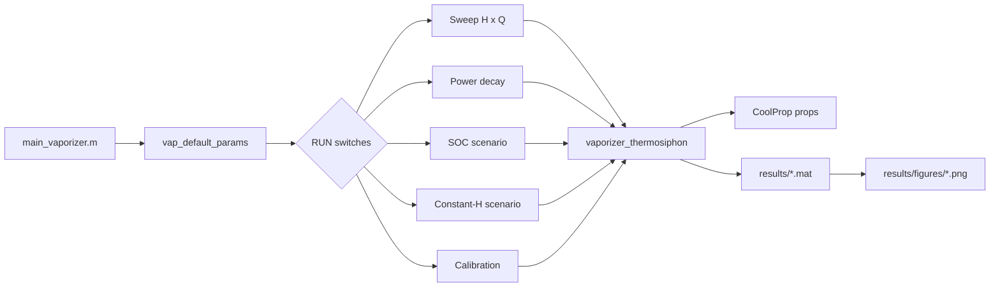

<div align="center">

# LH₂-PressureBuilder
### Vaporizer / Pressure-Builder Thermosiphon Model for Liquid Hydrogen Tanks

[](https://www.mathworks.com/products/matlab.html)
[](https://coolprop.org/)
[](https://www.gnu.org/licenses/gpl-3.0)

*A quasi-steady MATLAB model of natural circulation through an LH₂ pressure-builder vaporizer — bottom horizontal heater, vertical bare return into the ullage.*

**Repository:** [github.com/Albert-Gil/LH2-PressureBuilder](https://github.com/Albert-Gil/LH2-PressureBuilder)

</div>

---

This repository contains a **MATLAB-based reduced-order model** of the **pressure-builder (PB) vaporizer loop** of a horizontal cylindrical **liquid hydrogen (LH₂) tank**. Liquid leaves the tank bottom, is heated in a **horizontal fin-and-plate heater**, and returns through a **vertical bare pipe into the ullage**. The circulating mass flow is found from a steady balance between the liquid supply head, the return-pipe head, and hydraulic losses, with all fluid properties from **CoolProp**.

---

## 📌 Objective

This simulation tool is designed to:

- Predict the **circulating mass flow** and **outlet state** (temperature, vapor fraction) of the PB loop.
- Map performance over **liquid height** and **absorbed heater power**.
- Compare a **prescribed SOC drawdown** against a **constant liquid height** under identical power schedules.
- Follow a **decaying heater power** with liquid-to-vapor inventory transfer and exact tank geometry.
- Provide a reproducible **one-point loss calibration** against a measured flow.

---

## 🧠 Model Description

The model is a **quasi-steady natural-circulation** formulation at a representative constant loop pressure. The horizontal heater adds enthalpy but no vertical head; the vertical return is approximated as adiabatic, carrying fluid at the heater-outlet state.

### Core physics

| Module | Description |
|--------|-------------|
| **Energy balance** | \(h_{out} = h_L + \dot{Q}/\dot{m}\); inlet at imposed \(P, T_L\) (subcooled liquid) |
| **Supply head** | \(\rho_L(P,T_L)\, g\, H\) from the liquid height above the bottom takeoff |
| **Return head** | \(\rho_{out}(P,h_{out})\, g\, H_{elev}\) over the vertical return |
| **Losses** | Effective \(K_L\), \(K_g\) (fittings + heater passage), Darcy friction in supply and return pipes, homogeneous acceleration |
| **Friction factor** | Laminar / Haaland, smoothly blended over Re = 2300–4000 |
| **Two-phase closure** | Homogeneous no-slip density and viscosity, continuous at \(x = 0, 1\) |
| **Root search** | Bracketed search over valid property states, phase-boundary sampling, pressure/energy acceptance checks |
| **Failure handling** | `ok=false` means unknown flow (`mdot=NaN`), never zero; multiple roots reported, not selected |
| **Tank geometry** | Exact horizontal-cylinder height ↔ volume, stable at empty/full |
| **Inventory** | Only \(x_{out}\dot{m}\) transfers liquid → vapor; returned liquid stays liquid; no artificial level floor |

### Simulation workflow



### Study discretization

| Variable | Role | Default |
|----------|------|---------|
| `H_list`, `Qdot_list` | Sweep grid | 32 heights (0.25–2 m) × 50 powers (0.1–10 kW) |
| `scenario_t_end`, `scenario_dt` | SOC / constant-H duration and sample interval | 90 min, 30 s |
| `scenario_Q0`, `scenario_Q_end` | Shared power ramps | 8 kW → 8, 7, 6, 5, 4, 3 kW |
| `t_end`, `dt` | Power-decay duration and step | 30 min, 30 s |
| `Qdot0`, `Qdot_tau` | Power-decay start and time constant | 12 kW, 15 min |

Each sample is an independent steady solution; the power decay integrates inventory explicitly, so a smaller `dt` improves depletion accuracy.

---

## ⚙️ Thermodynamic Properties

All fluid properties are computed through **[CoolProp](https://coolprop.org/)** (`parahydrogen`), accessed from MATLAB via the **Python interface** (`py.CoolProp.CoolProp.PropsSI`).

| Property source | Usage |
|-----------------|-------|
| `vap_coolprop.m` | Strict SI wrapper; errors keep their cause and requested state |
| `vap_thermo.m` | Inlet (actual P,T) and saturation properties, cached per state |
| `vap_flow_state.m` | Outlet state, heads, and losses for a trial flow |

> **Note:** Inlet properties use the actual subcooled P,T state; saturated properties are used only for the two-phase closure. The EOS maximum temperature (or a user `T_out_max`) bounds the search.

---

## 🧰 Repository Structure

```
LH2-PressureBuilder/
├── main_vaporizer.m                 # Entry point — run this
├── README.md
├── LICENSE
├── requirements.txt                 # Python: CoolProp, numpy, scipy, matplotlib
├── .gitignore
│
├── model/                           # Solver core
│   ├── vaporizer_thermosiphon.m     # Steady circulation solve for one (H, Qdot)
│   ├── vap_flow_state.m             # Trial-flow state, heads, losses, residuals
│   ├── vap_thermo.m                 # Inlet and saturation properties
│   ├── vap_coolprop.m               # CoolProp wrapper
│   ├── vap_default_params.m         # Default parameters (SI)
│   └── vap_validate_params.m        # Derived geometry and input checks
│
├── geometry/                        # Tank geometry helpers
│   ├── HorizontalCyl_VolToLHeightAndSinterface.m
│   ├── vap_height_to_volume.m
│   └── vap_SOC_to_height.m
│
├── studies/                         # Studies called by main_vaporizer.m
│   ├── run_vaporizer_sweep.m
│   ├── run_vaporizer_power_decay.m
│   ├── run_vaporizer_SOC_scenario.m
│   ├── run_vaporizer_constH_scenario.m
│   ├── calibrate_vaporizer_loss.m
│   ├── vap_run_scenario.m           # Shared SOC / constant-H implementation
│   ├── vap_run_cases.m              # Array evaluation with failure records
│   ├── vap_scenario_schedule.m      # Shared time and power schedules
│   └── vap_update_inventory.m       # Liquid → vapor transfer
│
├── output/                          # Plotting and provenance
│   ├── vap_plot_results.m           # MATLAB figures
│   ├── vap_result_metadata.m        # Model / MATLAB / CoolProp versions
│   └── vap_results_dir.m            # Default output folder
│
├── python/
│   └── plot_vaporizer_results.py    # Optional batch plotter (same 11 figures)
│
└── results/                         # Saved datasets and figures
    ├── sweep_results.mat
    ├── power_decay_results.mat
    ├── SOC_scenario_results.mat
    ├── constH_scenario_results.mat
    └── figures/*.png
```

---

## 📄 Studies

Enable or disable studies with the switches at the top of `main_vaporizer.m`:

| Switch | Study | Output |
|--------|-------|--------|
| `RUN.sweep` | Height × power map at fixed P, T_L | `sweep_results.mat` |
| `RUN.power_decay` | Exponential power decay with liquid → vapor inventory transfer | `power_decay_results.mat` |
| `RUN.SOC` | Prescribed SOC drawdown (90 → 30 %) with shared power ramps | `SOC_scenario_results.mat` |
| `RUN.constH` | Constant height `H_ref` with the same power ramps | `constH_scenario_results.mat` |
| `RUN.calibration` | One-point effective `K_g` fit; defaults and saved results unchanged | workspace only |
| `RUN.python_plots` | Batch PNGs via `python/plot_vaporizer_results.py` | `results/figures/` |

All studies share one parameter struct `p`, so the SOC and constant-height scenarios always use identical time and power inputs.

---

## ▶️ How to Run

### 1. Clone the repository

```bash
git clone https://github.com/Albert-Gil/LH2-PressureBuilder.git
cd LH2-PressureBuilder
```

### 2. Install CoolProp (Python)

```bash
pip install -r requirements.txt
```

Verify in Python:

```python
import CoolProp.CoolProp as CP
CP.PropsSI('T', 'P', 101325, 'Q', 0, 'Parahydrogen')
```

### 3. Configure MATLAB ↔ Python

Open MATLAB from the project root. If Python is not yet linked, configure once (adjust the path to your Python executable):

```matlab
pyenv('Version', 'C:\Path\To\python.exe');
```

Tested with MATLAB R2026a, Python 3.12.10, CoolProp 7.2.0.

### 4. Run the studies

```matlab
main_vaporizer
```

**Options** in `main_vaporizer.m`:

| Setting | Default | Effect |
|---------|---------|--------|
| `RUN.*` | four studies on | Select which studies run |
| `makePlots` | `true` | Save MATLAB figures to `<outputDir>/figures` (desktop MATLAB) |
| `outputDir` | `''` | Empty means `results/` |
| `calibration_target_kg_min` | `0.30` | Target flow for `RUN.calibration` |

Results are also returned in the workspace struct `results`.

### 5. Customize a case

Edit the Parameters section of `main_vaporizer.m`; every enabled study uses the modified `p`:

```matlab
p = vap_default_params();
p.D = 0.025;        % pipe ID; area is recomputed automatically
p.T_L = 25;         % inlet temperature [K]
p.K_g = 9.70224;    % e.g. the calibrated return loss
```

Keep `H_elev` and `L_vap` empty to derive them from the tank diameter, or set measured values.

---

## 📈 Outputs

Each study saves a `.mat` file to `results/` with validity flags, solver status and messages, pressure/energy residuals, and provenance metadata (model version, timestamp, MATLAB and CoolProp versions).

### Key fields

- **Sweep:** `mdot_map`, `Tout_map`, `x_map`, reference point `sp`, complete-vaporization boundary `ceiling_vs_Q`
- **Scenarios:** `t`, `H`, `Qdot`, `mdot`, `T_out`, `x_out`, paired means `mean_mdot`, `mean_T_out`
- **Power decay:** `Qdot`, `H`, `mdot`, `T_out`, `mass_L`, `mass_vaporized`

### Figures

Eleven figures are written to `results/figures/`: flow and outlet-temperature maps over height × power, flow/temperature/vapor-fraction curves at the reference point, the power-decay transient, and driver and response plots for both scenarios.

<div align="center">
 
</div>

---

## 🎯 Calibration

With the historical effective losses (`K_L = 7.5`, `K_g = 6.0`), the model predicts **≈ 0.401 kg/min and 71.9 K** at 8.273 bar, 27 K inlet, H = 1.54 m, and 6 kW. An optional one-point fit to the approximate field flow of 0.30 kg/min is provided:

```matlab
[p_fit, fit] = calibrate_vaporizer_loss(0.30);
% K_L stays 7.5; effective K_g ≈ 9.70224; T_out ≈ 96.25 K
```

The fit does **not** modify defaults or saved results. Because outlet temperature follows from power and flow, it is not an independent hydraulic constraint; off-design flow or pressure-drop measurements are needed to validate the losses.

---

## 📜 References

**1.**  
> **Bell, I. H., Wronski, J., Quoilin, S., Lemort, V.**  
> *Pure and Pseudo-pure Fluid Thermophysical Property Evaluation and the Open-Source Thermophysical Property Library CoolProp*,  
> **Industrial & Engineering Chemistry Research**, 53(6), 2014, pp. 2498–2508.  
> https://doi.org/10.1021/ie4033999

**2.**  
> **IAEA**, *Natural circulation in water cooled nuclear power plants*, IAEA-TECDOC-1474, 2005.  
> https://www-pub.iaea.org/MTCD/Publications/PDF/TE_1474_web.pdf

**3.**  
> **IAEA**, *Natural circulation phenomena and modelling for advanced water cooled reactors*, IAEA-TECDOC-1677, 2012.  
> https://www-pub.iaea.org/MTCD/Publications/PDF/TE-1677_web.pdf

---

## ⚠️ Notes & Limitations

- Intended for **academic and research use**.
- The vertical return is treated as **adiabatic**; significant heat exchange on the bare pipe requires a heat-leak model.
- Heater passage geometry is unknown; its resistance is **lumped into effective K losses**.
- **Homogeneous no-slip** two-phase flow; slip, flow regimes, and stability are not modeled.
- `P` and `T_L` are **imposed reservoir conditions**; this is not a closed-tank pressurization transient.
- **Quasi-steady** only: startup, wall heat storage, and heater temperature at zero flow are not resolved.
- Numerical convergence verifies the equations, **not experimental accuracy**; the single calibration point is not validation.
- This repository **may not be regularly maintained or updated**.
- **No warranty** is provided. Use at your own risk.

---

## 👤 Author

**Albert Gil**  
PhD Researcher, University of California, Irvine  
[LinkedIn](https://www.linkedin.com/in/albertgilesmendia/)

---

## 📄 License

This project is released under the **GNU General Public License v3.0**.  
See the [`LICENSE`](LICENSE) file or [https://www.gnu.org/licenses/gpl-3.0.html](https://www.gnu.org/licenses/gpl-3.0.html).

---

## 📬 Contact

For questions, bug reports, or collaboration opportunities, please **open an issue** on GitHub or reach out via LinkedIn.
